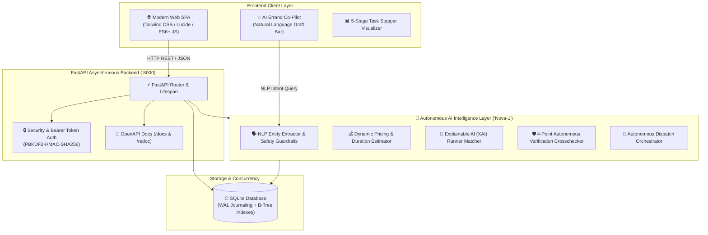

# ErrandMate — Modern Errand Platform with Autonomous AI Engine

[](https://fastapi.tiangolo.com)
[](https://www.python.org)
[](#-autonomous-ai-engine--agent-architecture)
[](https://www.sqlite.org)
[](https://tailwindcss.com)
[](https://docs.pytest.org)
[](https://www.docker.com)

**ErrandMate** is a full-stack, collaborative local task marketplace and autonomous dispatch platform designed for modern communities. Users can easily post errands (grocery runs, pharmacy pickups, parcel deliveries, pet care, household help), browse open listings, and coordinate deliveries with verified runners.

The platform combines an asynchronous **FastAPI REST API**, an autonomous **AI Engine ("Nova-1")**, and a fluid, responsive **Web SPA** featuring 5-stage lifecycle state tracking, real-time dynamic pricing, and automated fraud-prevention crosschecks.

---

## 🏗️ System & AI Architecture



---

## 🧠 Autonomous AI Engine & Agent Architecture

Designed specifically to demonstrate cutting-edge Computer Science & AI capabilities:

### 1. NLP Keyword & Entity Categorizer (`server/ai/nlp_extractor.py`)
* Converts conversational natural language prompts (e.g. *"I live in Elmfield road cf24 9zz 14 maplewood street and i need somone to walk my dog on monday 21 , pm"*) into structured entity categories:
  * **Categorized Address**: Extracts street numbers, primary and secondary streets, areas, and UK postcodes (e.g., `14 Maplewood Street, Elmfield Road, CF24 9ZZ`).
  * **Categorized Task & Action**: Isolates action keywords, subject phrases, and maps to service taxonomy (e.g., `walk my dog` ➔ `Pet Care`).
  * **Categorized Time & Schedule**: Resolves natural language days, 12h/24h timestamps, and am/pm markers (e.g., `Monday at 21:00 (9:00 PM)`).
  * **Keywords & Tokens**: Tokenizes descriptive nouns and verbs for downstream semantic indexing.
* **Safety & Content Moderation Guardrails**: Proactively flags prohibited items (illicit substances, hazardous goods, policy violations).

### 2. Predictive Dynamic Pricing & Labor Estimator (`server/ai/pricing_engine.py`)
* Multi-factor heuristic regression estimating fair market compensation, physical effort index, and expected duration in minutes.
* **Living-Wage Protection**: Identifies underpriced errands that risk runner exploitation.
* **Anti-Fraud Anomaly Detection**: Flags suspicious extreme prices (e.g. £500 for a 1-minute errand).

### 3. Explainable AI (XAI) Runner Matching (`server/ai/matching_engine.py`)
* Evaluates active runners across 4 multi-criteria affinity vectors:
  1. *Category Affinity* (historical completions in category)
  2. *Runner Reliability & Reputation* (Bayesian smoothed star rating & volume)
  3. *Active Workload & Capacity*
  4. *Geographic Locality Proximity*
* Outputs transparent **Match Percentages (0–100%)** alongside **Explainable AI (XAI) Reason Tags** (e.g., *"⭐ 4.9 Rating"*, *"🎯 Category Specialist: 12 jobs"*, *"🟢 Immediate Availability"*).

### 4. 4-Point Autonomous Verification Crosscheck (`server/ai/crosscheck_engine.py`)
Executes an automated defense-in-depth audit before release of completion:
* **Temporal Plausibility**: Verifies elapsed duration against predicted physical duration bounds (flags instant suspicious completions).
* **Semantic Keyword Alignment**: Cross-references deliverables between original task instructions and runner proof notes.
* **Identity Segregation**: Strictly prevents self-assignment and conflict of interest.
* **Financial Ledger Audit**: Confirms agreed escrow payout validity.

### 5. Autonomous Dispatch Agent: Nova-1 (`server/ai/autonomous_agent.py`)
* Autonomous dispatch triggers: Automatically pairs open errands with the highest-affinity candidate (>65% affinity threshold).
* Telemetry metrics: Tracks total NLP extractions, pricing analyses, autonomous crosschecks, verified completions, and flagged anomalies.

---

## 💻 Tech Stack Matrix

| Domain | Technologies & Libraries |
| :--- | :--- |
| **Backend Framework** | Python 3.9+, FastAPI, Starlette, Uvicorn (ASGI) |
| **AI & ML Intelligence** | Natural Language Processing (NLP), Multi-Criteria Decision Analysis (MCDA), Heuristic Dynamic Pricing, Explainable AI (XAI) |
| **Data Validation** | Pydantic v2 (Strict typing, JSON Schema validation) |
| **Database & Concurrency**| SQLite 3, Write-Ahead Logging (WAL Mode), Row Factory, Foreign Keys, B-Tree Indexes |
| **Security & Privacy**| PBKDF2-HMAC-SHA256 (100,000 iterations), HMAC-SHA256 Bearer Tokens, Constant-Time Comparison (`compare_digest`), Real-ID Anti-Fraud Verification (Address, Postcode, Official ID Document Validation) |
| **Frontend UI/UX** | HTML5, Tailwind CSS, Vanilla ES6+ JavaScript, Lucide Icons, Glassmorphic Accents |
| **Testing & CI** | Pytest, HTTPX TestClient, 14 passing automated tests |
| **DevOps & Containers** | Docker, Docker Compose, Multi-stage Builds, Healthchecks |

---

## 🚦 Interactive Errand Lifecycle State Machine

```text
[1. Open] ──(Runner Accepts)──> [2. Accepted] ──(Runner Starts)──> [3. In Progress]
                                                                          │
[5. Completed] <──(Poster Confirms & Rates)── [4. Awaiting Confirmation] <─┘
      │                                                (Runner Submits)
      └──> (AI 4-Point Autonomous Crosscheck Verified)
```

---

## ⚡ Quick Start & Live Execution

### 1. Prerequisites
* Python 3.9+ installed on your system.

### 2. Clone & Setup
```bash
git clone https://github.com/your-username/ErrandMate_modern_ui.git
cd ErrandMate_modern_ui
```

### 3. Run Server (Cross-Platform)

**On macOS / Linux:**
```bash
./run_server.sh
```

**On Windows:**
```cmd
run_server.bat
```

**Direct Python:**
```bash
python run_server.py
```

* 🌐 **Web Application**: [http://127.0.0.1:8000/](http://127.0.0.1:8000/)
* 📖 **Swagger API Docs**: [http://127.0.0.1:8000/docs](http://127.0.0.1:8000/docs)
* 📚 **ReDoc Reference**: [http://127.0.0.1:8000/redoc](http://127.0.0.1:8000/redoc)
* 🧠 **AI Telemetry**: [http://127.0.0.1:8000/api/ai/telemetry](http://127.0.0.1:8000/api/ai/telemetry)
* 🩺 **Health Check**: [http://127.0.0.1:8000/api/health](http://127.0.0.1:8000/api/health)

---

## 👥 Built-in Recruiter Demo Personas

To test both sides of the marketplace without registering manual accounts:
* **Platform Admin**: `admin` / `admin123` *(No email required! Quick one-click sign-in button)*
* **Jane Foster (Task Poster, ID-Verified)**: `poster@errandmate.com` / `Password123!`
* **Bob Walker (Elite Runner, 4.9★, 28 runs, ID-Verified)**: `runner@errandmate.com` / `Password123!`
* **Alan Sunny (CS & AI Student, ID-Verified)**: `student@errandmate.com` / `Password123!`

*Tip: Use the top-right "Demo Persona" selector in the web app to switch accounts instantly!*

---

## 🧪 Automated Test Suite

Run the full suite of unit, integration, security, identity, and AI tests:
```bash
./.venv/bin/pytest
```
```text
tests/test_ai.py ....                                                    [ 25%]
tests/test_api.py ......                                                 [ 62%]
tests/test_database.py ..                                                [ 75%]
tests/test_security.py ....                                              [100%]

============================== 16 passed in 0.50s ==============================
```

---

## 📄 License
Academic & Portfolio Showcase Project. Licensed under the MIT License.
